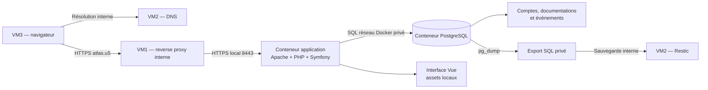

# Atlas — Rapport de fonctionnement et d’architecture

## 1. Objectif et périmètre

Atlas centralise les procédures informatiques d’Atlas Conseil. Les collaborateurs consultent une bibliothèque interne ; les administrateurs publient les guides, gèrent les accès et analysent les événements de sécurité.

Le service fonctionne sans API externe, messagerie sortante, publicité, outil de suivi tiers ou ressource graphique distante. Le logo SVG, les icônes, les styles et le JavaScript sont servis par Atlas. La préparation initiale des images peut télécharger les dépendances sur un poste de construction ; le déploiement peut ensuite se faire hors ligne avec les images exportées.

## 2. Architecture

Les composants applicatifs sont opérationnels dans Docker. Le DNS, le reverse proxy lié à l’adresse privée de VM1 et le dépôt Restic sont les points d’intégration de l’infrastructure d’Ange ; ils ne sont pas configurés sur ce poste par le code applicatif.

### Composants

| Composant | Rôle |
| --- | --- |
| Vue 3 et Vue Router | Affichage, navigation, éditeur interactif et aperçu |
| Symfony 7.4 | Routes de l’API, sessions, authentification et autorisations |
| PHP 8.4 et PDO | Validation et requêtes préparées PostgreSQL |
| Apache du conteneur | Service des ressources locales, HTTPS et redirection HTTP |
| PostgreSQL 17 | Comptes, documents et journal applicatif |
| Docker Compose | Démarrage, vérification de disponibilité, volumes et réseaux |

L’interface et l’API partagent une origine. Le navigateur appelle uniquement des routes relatives `/api/...`. La navigation Vue utilise des fragments d’URL (`#/connexion`, `#/categories`), ce qui simplifie le passage par le reverse proxy.

## 3. Parcours et pages

| Page | Accès et fonctionnement |
| --- | --- |
| Connexion | Mise en page indépendante, sans navigation privée ni inscription libre |
| Bibliothèque | Recherche dans les titres, résumés et catégories |
| Catégories | Regroupement des documentations et filtre de la bibliothèque |
| Lecture d’un guide | Sections, notes, checklists, commandes, sommaire et temps estimé |
| Aide | Prise en main, accès et instructions adaptées au rôle connecté |
| Confidentialité / RGPD | Informations sur les données, finalités, conservation et droits ; accessible avant connexion |
| Création / édition | Administrateurs uniquement ; composition par blocs et aperçu |
| Comptes & accès | Création de compte, attribution du rôle, désactivation et réactivation |
| Journal d’activité | Administrateurs uniquement ; compteurs, histogramme et événements récents |
| Erreurs | Pages personnalisées 404 et accès refusé ; erreur HTTP 404 également traitée côté serveur |

Un administrateur choisit un titre, une catégorie et un résumé, puis assemble jusqu’à 30 blocs. Les blocs peuvent être déplacés par glisser-déposer ou avec les boutons de réorganisation. L’aperçu utilise le même composant de rendu que la lecture. La publication stocke les blocs JSON et un équivalent textuel dans PostgreSQL. Le serveur contrôle les types de blocs et les limites de longueur : un contenu total de 10 000 caractères maximum, avec des limites propres aux champs.

Les anciens guides en texte restent lisibles. Leur édition les convertit en blocs sans interpréter du HTML. Les nouveaux contenus ne peuvent pas charger d’images ou de scripts distants.

## 4. Modèle de données

- **users** : identifiant, nom, adresse de compte, mot de passe haché, rôle, statut actif et date de création.
- **documents** : titre, catégorie, résumé, texte, blocs JSON, date de mise à jour et identifiant du créateur lorsqu’il est disponible.
- **audit_events** : type, date, identité du compte, adresse réseau observée et référence de l’objet concerné. La clé de limitation des tentatives est interne et n’est pas renvoyée au navigateur.

Les évolutions du schéma s’appliquent au démarrage sans supprimer les données existantes. Sur une base vide, l’initialisation crée uniquement l’administrateur configuré dans `.env` et les deux guides initiaux. Les autres comptes sont créés par un administrateur connecté. Une installation existante conserve ses comptes et ses mots de passe.

## 5. Contrôle des accès et protections

La navigation masque les fonctions non autorisées, et Symfony contrôle indépendamment les droits sur chaque route d’administration. Un utilisateur ne peut ni créer un compte, ni publier ou modifier une documentation, ni consulter le journal d’activité.

Les mots de passe sont hachés. Les requêtes SQL utilisent des paramètres préparés. La création et la modification exigent un jeton CSRF lié à la session ; les connexions sont également protégées par CSRF. Les réponses de compte et les événements ne contiennent aucun mot de passe ou hachage.

Le fournisseur d’utilisateurs recharge le compte depuis PostgreSQL. Un compte désactivé perd son accès à la prochaine requête. Un changement de rôle invalide la session précédente. La session expire après 30 minutes d’inactivité ; un rechargement renvoie vers la connexion, tandis que l’API répond HTTP 401 ; son cookie est HttpOnly, SameSite et Secure en HTTPS. Cinq échecs pour le même couple identifiant / adresse réseau entraînent une limitation de 15 minutes.

Les réponses applicatives imposent une politique CSP limitée à la même origine, interdisent l’intégration dans une iframe, désactivent la détection automatique du type de contenu et empêchent la mise en cache des réponses sensibles. Aucun HTML libre n’est rendu dans les documents. Les clés et secrets restent côté serveur ; aucune clé API externe n’est utilisée.

Ces protections et les tests décrits ci-dessous couvrent les parcours actuels. Ils ne constituent pas une garantie d’absence de toute vulnérabilité future.

## 6. HTTPS et frontières réseau

Le script de démarrage génère une autorité locale et un certificat pour `atlas.u5`, `localhost` et `127.0.0.1`. Il ne contacte aucune autorité publique. Les navigateurs clients doivent faire confiance à `certs/ca.crt`. Cette confiance n’a pas été installée automatiquement dans le système du poste.

Le port HTTP redirige vers HTTPS, y compris pour les ressources statiques. HSTS est envoyé sur les réponses HTTPS. La clé privée de l’autorité reste sur le serveur ; seuls le certificat et la clé serveur nécessaires sont montés pour Apache, ainsi que le certificat public de l’autorité pour le contrôle de disponibilité.

Les ports 8080 et 8443 sont publiés uniquement sur la boucle locale de VM1. PostgreSQL n’a pas de port publié et son réseau Docker est interne. Un second réseau permet l’entrée locale vers l’application, avec masquage IP désactivé et sans résolveur DNS externe configuré pour l’application. Le code ne contient aucun appel à un service Internet.

L’inaccessibilité depuis Internet doit également être maintenue par l’infrastructure : reverse proxy lié à l’adresse privée, DNS interne et règles réseau excluant les interfaces publiques. Le serveur applicatif ne modifie pas les règles de routage ou de pare-feu de l’hôte.

## 7. Journal d’activité et données personnelles

Le journal permet de savoir quel compte s’est connecté, quand, et avec quel résultat. Il consigne aussi les publications, modifications et opérations sur les comptes. Un identifiant saisi lors d’un échec ne prouve pas l’identité de son auteur. L’adresse réseau affichée est celle observée par le serveur ; derrière un proxy, elle peut être celle du relais. Les en-têtes de proxy ne sont pas acceptés aveuglément.

Les compteurs portent sur les connexions de la période. Le filtre d’événements agit sur le tableau, limité aux 200 événements les plus récents. L’histogramme est calculé localement à partir des événements PostgreSQL ; aucun traceur navigateur tiers n’est utilisé.

La durée de 30 jours est un choix de conservation du journal applicatif, avec purge à la lecture ou à l’ajout d’événements. Les journaux techniques Docker sont limités à trois fichiers de 10 Mo par service. La désactivation d’un compte n’efface pas ses données ; les demandes d’effacement sont traitées par le service informatique, y compris la politique des sauvegardes.

La page de confidentialité décrit ces traitements et l’exercice des droits par le canal interne. Sa base légale et les durées doivent être confirmées par le responsable d’Atlas Conseil. Son information s’appuie sur les principes de [transparence](https://www.cnil.fr/fr/informer-les-personnes), de [minimisation](https://www.cnil.fr/fr/minimiser-les-donnees-collectees) et de [journalisation](https://www.cnil.fr/fr/securite-tracer-les-operations) de la CNIL. Ces références documentaires ne sont pas des services utilisés par le portail.

## 8. Exploitation et restauration

Le démarrage attend la disponibilité de PostgreSQL puis du service HTTPS. Le contrôle applicatif vérifie le certificat local et la réponse de `/api/health`. Le volume PostgreSQL conserve les données entre les redémarrages.

`export-db.sh` produit un export privé qui inclut comptes, documentations et événements. `restore-test.sh` importe cet export dans une autre base, adapte le schéma et vérifie les données sans ajouter artificiellement des comptes ou des guides manquants. Les certificats et `.env` font l’objet d’une sauvegarde protégée distincte. La sauvegarde Restic et son stockage restent internes à VM2.

## 9. Validation

Ont été vérifiés : construction Vue et Docker, configuration Symfony, connexion et déconnexion, droits utilisateur / administrateur, CSRF, création de documentation structurée, lecture et modification, types de blocs refusés, limitation des tentatives, désactivation de session, expiration à 30 minutes, journal et filtres, absence de secrets dans les réponses, cookie Secure, CSP, certificat HTTPS validé, redirection HTTP et page HTTP 404.

Une installation vide a été testée : un seul compte administrateur est créé. Les essais qui créent des comptes ou des documents utilisent une base séparée. Les parcours visuels sont vérifiés dans une instance locale de validation ; HTTPS est contrôlé avec la vraie autorité locale, sans désactiver la validation du certificat.

Les tests DNS, accès depuis VM3 et récupération Restic nécessitent le raccordement de l’infrastructure d’Ange. Les procédures de réplication sont dans le README anglais ; les résultats détaillés et captures figurent dans `RESULTATS.md` et `preuves/`.

## 10. Partage des sources et renouvellement des accès

Le dépôt contient les sources, les fichiers de verrouillage des dépendances et `backend/.env` avec des valeurs de développement. Le `.env` privé à la racine, les clés, certificats, exports SQL et archives d’images restent exclus. Docker injecte les secrets propres à chaque installation. Une copie limitée aux sources publiables a été démarrée et vérifiée avec une base vide.

Les tests utilisent des identifiants fournis par l’environnement, sans mot de passe de compte intégré au code. La commande locale `app:reset-password` permet à l’opérateur du serveur de renouveler un mot de passe existant avec une saisie masquée et confirmation. Elle hache la nouvelle valeur et invalide les anciennes sessions à la prochaine requête. Aucun service externe ni route publique de réinitialisation n’est ajouté. Les anciens accès doivent être renouvelés avant publication des sources ; Git ne transfère pas la base de données ni les comptes d’une installation.
